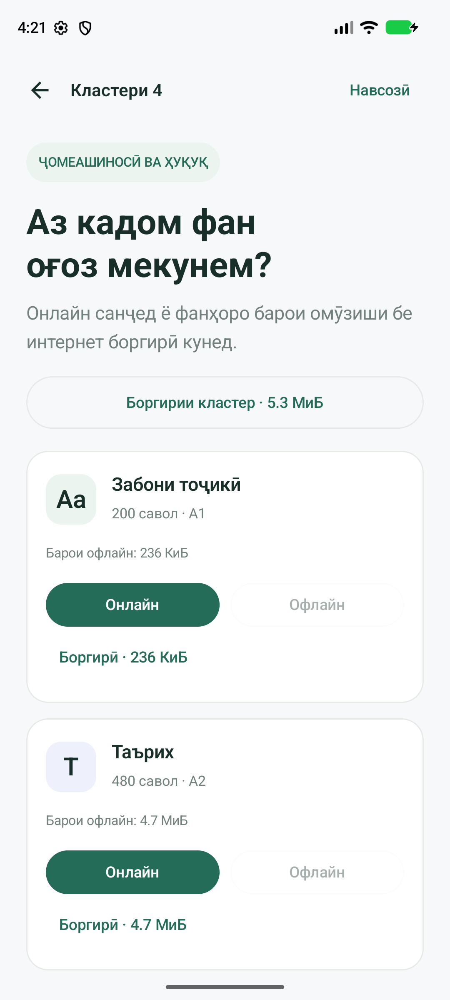
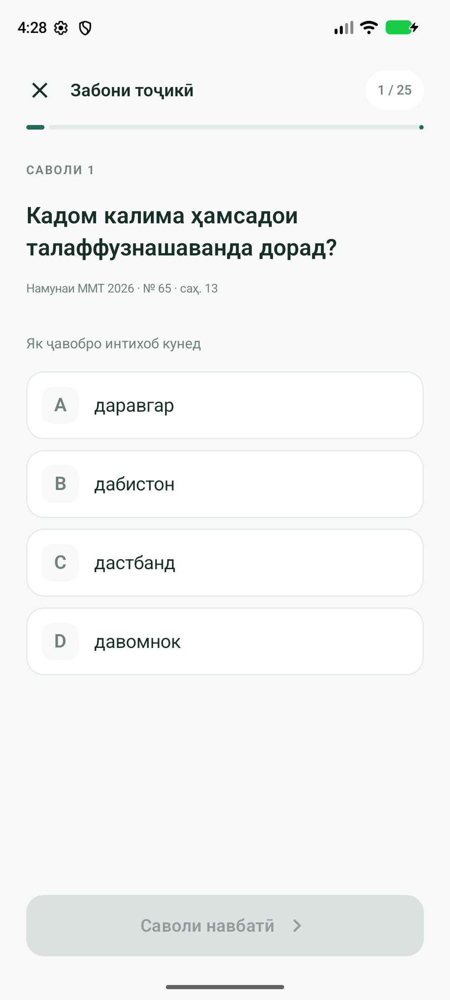
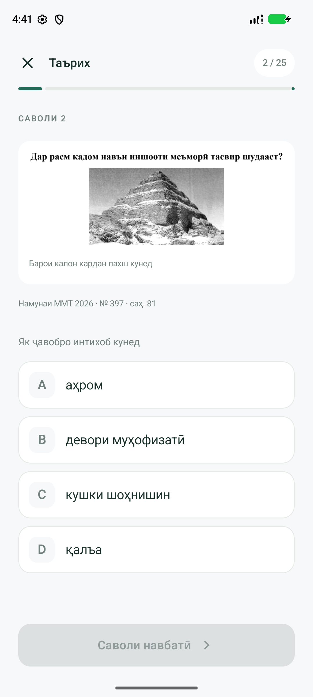

# Omoda · Омода

**Подготовка к ММТ на Android — онлайн и офлайн, на таджикском языке.**

Omoda помогает абитуриентам тренироваться по предметам пяти кластеров ММТ в Таджикистане. Выберите кластер и предмет, ответьте на 25 вопросов и сразу узнайте результат. Для онлайн-теста приложение получает готовые вопросы из обновляемой базы. Для занятий без интернета можно скачать отдельный предмет или кластер целиком. Регистрация не нужна.

**5 кластеров · 10 предметов · Обновление базы без нового APK · Android 8.0+**

<p>
  
  
  
</p>

## Возможности

- **Онлайн и офлайн.** Пройти тест через интернет или заранее скачать предметы и целый кластер.
- **Маленький APK.** В установочном файле нет банков вопросов и их изображений; материалы загружаются отдельно.
- **Обновляемая база НЦТ.** Автоматический импорт PDF заданий и ключей публикует проверенные версии независимо от приложения.

- **Тесты по всем пяти кластерам.** Для каждого кластера доступны четыре профильных предмета.
- **25 случайных вопросов за попытку.** Внутри теста вопросы не повторяются; при новой попытке формируется новая выборка.
- **Мгновенная проверка.** После выбора ответа приложение показывает правильный вариант. Результат обозначается цветом, текстом и значками.
- **Формулы и иллюстрации.** Визуальные фрагменты исходных материалов сохраняют математическую запись, рисунки и оформление стихотворений. Изображение условия можно открыть в увеличенном виде.
- **Итоги теста.** Количество правильных и ошибочных ответов, процент результата и возможность начать заново.
- **Восстановление текущей попытки.** Порядок вопросов, ответы и позиция сохраняются при повороте экрана и восстановлении процесса системой.

Интерфейс и названия предметов — на таджикском языке. Содержание заданий по английскому языку — на английском.

## Кластеры и предметы

| Кластер | Направление | Предметы |
| --- | --- | --- |
| 1 | Табиӣ ва техникӣ | Забони тоҷикӣ, Математика, Химия, Физика |
| 2 | Иқтисод ва география | Забони тоҷикӣ, Математика, География, Забони англисӣ |
| 3 | Филология, педагогика ва санъат | Забони тоҷикӣ, Таърих, Адабиёти тоҷик, Забони англисӣ |
| 4 | Ҷомеашиносӣ ва ҳуқуқ | Забони тоҷикӣ, Таърих, Ҳуқуқ, Забони англисӣ |
| 5 | Тиб, биология ва варзиш | Забони тоҷикӣ, Биология, Химия, Физика |

Один предмет использует общий банк во всех кластерах, где он встречается.

## База вопросов

Используются задания с одним правильным ответом из материалов ИМД 2026 и соответствующие ключи. Каталог обновляется из опубликованной базы. При проверке полного автоматического импорта 28 октября 2026 получено 4 692 вопроса.

Ниже приведён начальный набор из репозитория, используемый для первой публикации. Актуальные количества приложение показывает из сетевого каталога:

| Предмет | Файл банка | Вопросов |
| --- | --- | ---: |
| Забони тоҷикӣ | `tajik.json` | 200 |
| Математика | `math.json` | 200 |
| География | `geography.json` | 200 |
| Забони англисӣ | `english.json` | 190 |
| Биология | `biology.json` | 472 |
| Химия | `chemistry.json` | 519 |
| Физика | `physics.json` | 504 |
| Таърих | `history.json` | 480 |
| Ҳуқуқ | `law.json` | 414 |
| Адабиёти тоҷик | `literature.json` | 312 |
| **Всего уникальных вопросов** | | **3 491** |

В начальном наборе для таджикского языка, математики и географии включены первые 200 вопросов; для английского — 190 заданий раздела Practical Items. Для биологии, химии, физики, истории, права и литературы включены полные разделы с одним правильным ответом.

## Как пользоваться

1. Выберите кластер на главном экране.
2. Нажмите **«Онлайн»** у нужного предмета или скачайте его через **«Боргирӣ»**, затем выберите **«Офлайн»**. Для загрузки всех предметов есть кнопка **«Боргирии кластер»**.
3. Выберите один из четырёх вариантов ответа. Первый ответ фиксируется, изменить его нельзя.
4. Посмотрите правильный ответ и перейдите к следующему вопросу.
5. После последнего вопроса откройте результат и при желании начните новую попытку.

Ограничения по времени нет. При выходе из теста через интерфейс текущая попытка прекращается.

## Сборка и запуск

### Требования

- Android Studio с поддержкой Android Gradle Plugin 8.13.2.
- JDK 17 или 21.
- Android SDK Platform 35.
- Устройство или эмулятор с Android 8.0 (API 26) и выше.

При первой сборке понадобится интернет для загрузки Gradle и зависимостей. Для онлайн-тестов и скачивания предметов также нужен интернет. Скачанные предметы работают офлайн.

### Через Android Studio

1. Клонируйте репозиторий:
   ```bash
   git clone https://github.com/abdusi/Omoda.git
   cd Omoda
   ```
2. Откройте папку проекта в Android Studio и дождитесь Gradle Sync.
3. В настройках Gradle выберите JDK 17 или 21, установите SDK 35 через SDK Manager.
4. Выберите устройство и нажмите **Run**.

Путь к Android SDK задаётся в локальном `local.properties` через `sdk.dir` или переменную окружения `ANDROID_HOME`. Файл `local.properties` не добавляется в Git.

### Через терминал

Windows PowerShell:

```powershell
.\gradlew.bat :app:assembleDebug
.\gradlew.bat :app:installDebug
```

macOS / Linux:

```bash
bash ./gradlew :app:assembleDebug
bash ./gradlew :app:installDebug
```

Команда `installDebug` требует подключённого устройства или запущенного эмулятора. Собранный APK: `app/build/outputs/apk/debug/app-debug.apk`.

## Технологии и структура

| Компонент | Технология |
| --- | --- |
| Язык | Kotlin 2.0.20 |
| Интерфейс | Jetpack Compose, Material 3 |
| Состояние экранов | ViewModel, SavedStateHandle |
| Данные | Локальные JSON-банки и WebP-изображения |
| Сборка | Gradle 8.13, Android Gradle Plugin 8.13.2 |
| Android | minSdk 26, targetSdk / compileSdk 35 |
| Версия приложения | 0.5.0 |

```text
app/src/main/
├── java/tj/mmt/prep/
│   ├── MainActivity.kt     # Экраны Compose и тема
│   ├── PrepViewModel.kt    # Навигация и восстановление состояния
│   ├── QuestionBank.kt     # Каталог кластеров, загрузка и проверка банков
│   ├── ContentRepository.kt # Сеть, пакеты предметов и локальные попытки
│   ├── ContentFiles.kt      # Проверка путей, архивов и хешей
│   └── QuizSession.kt      # Выборка вопросов, ответы и подсчёт результата
├── bootstrap/catalog.json  # Единственный каталог, включённый в APK
└── assets/                  # Начальная база для публикации, исключена из APK
    ├── *.json              # 10 предметных банков
    └── questions/          # Иллюстрации условий и вариантов ответа
app/src/test/               # Unit-тесты логики и каталога
tools/                      # Импорт PDF, проверка банков и smoke-сценарии
preview/                    # Скриншоты и сохранённые протоколы проверок
```

## Проверки

Unit-тесты и Android Lint:

```powershell
.\gradlew.bat :app:testDebugUnitTest :app:lintDebug
```

На macOS / Linux используйте `bash ./gradlew` вместо `.\gradlew.bat`. Тесты проверяют выборку без повторов, фиксацию ответа, подсчёт результата, восстановление сессии и состав кластеров.

Для Python-инструментов установите зависимости:

```bash
python -m pip install -r tools/requirements.txt
python -m unittest discover -s tools -p "test_*.py" -v
```

Полная проверка банков сверяет JSON, изображения и ключи из исходных PDF. Передайте папки материалов в порядке **2, 5, 4, 3**:

```bash
python tools/validate_bank.py "materials/cluster2" "materials/cluster5" "materials/cluster4" "materials/cluster3"
```

Исходные PDF и ключи нужно подготовить отдельно: в репозитории находятся готовые банки и изображения. Проверка банков требует исходных материалов даже при отсутствии изменений в данных.

## Автоматическое обновление

GitHub Actions загружает PDF и ключи с таджикской страницы НЦТ, извлекает вопросы, проверяет полноту и публикует версионные банки в ветку `content`. APK получает готовый текст и необходимые изображения. Ежедневный запуск — 06:17 по Ташкенту, после включения workflow в `main`.

Проверка небольшого импорта без публикации:

```bash
python tools/sync_ntc.py --subjects law --limit 25
```

Полный импорт:

```bash
python tools/sync_ntc.py
```

При ошибках исходного сайта или разметки последняя опубликованная база сохраняется. Формулы и схемы остаются изображениями там, где надёжное представление текстом не подготовлено. Подробности, формат пакетов и порядок публикации — в [docs/CONTENT.md](docs/CONTENT.md).

## Добавление вопросов

Банки находятся в [app/src/main/assets](app/src/main/assets), изображения — в `questions/<subject>/` внутри этой папки. Каждый банк — JSON-массив вопросов.

| Поле | Содержание |
| --- | --- |
| `id` | Уникальный идентификатор внутри предмета |
| `number`, `page`, `source` | Номер задания, страница и имя исходного PDF |
| `prompt` | Условие: `text`, `image`, `width`, `height`, `visual` |
| `options` | Четыре варианта с той же структурой, что и условие |
| `correct` | Индекс правильного варианта: `0` = A, `1` = B, `2` = C, `3` = D |

Путь `image` задаётся относительно `assets`; размеры — в пикселях. При `visual: true` приложение отображает изображение. В каждом предмете должно оставаться не менее 25 вопросов.

Для импорта подготовленных PDF используйте [tools/import_bank.py](tools/import_bank.py):

```bash
python tools/import_bank.py "materials/cluster2" --cluster 2 --limit 200
python tools/import_bank.py "materials/cluster3" --cluster 3 --limit 0
python tools/import_bank.py "materials/cluster4" --cluster 4 --limit 0
python tools/import_bank.py "materials/cluster5" --cluster 5 --limit 0
```

`--limit 0` импортирует весь поддерживаемый раздел. Импортёр рассчитан на конкретную разметку исходных материалов; для других PDF потребуется адаптация. Он перезаписывает соответствующие банки и изображения, поэтому сохраните ручные изменения перед запуском. После импорта выполните проверку банков и просмотрите визуальные фрагменты.

## Текущие ограничения

- Приложение предназначено для учебной тренировки и не воспроизводит полную структуру экзамена и систему официальных баллов.
- Задания на соответствие, краткий ответ и английские задания с общим текстом пока не включены.
- Постоянной истории результатов и учётных записей нет.
- Для скачивания нужно оставить приложение открытым до завершения. После прерванной процессом загрузки пакет скачивается заново.
- Сканированные PDF без читаемого текстового слоя требуют адаптации/OCR; неоднозначные материалы автоматически не публикуются.
- Переключение языка и загрузка PDF из приложения не предусмотрены.
- Команды выше создают debug-сборку для тестирования; публикация в магазине требует отдельной настройки release-сборки и подписи.
